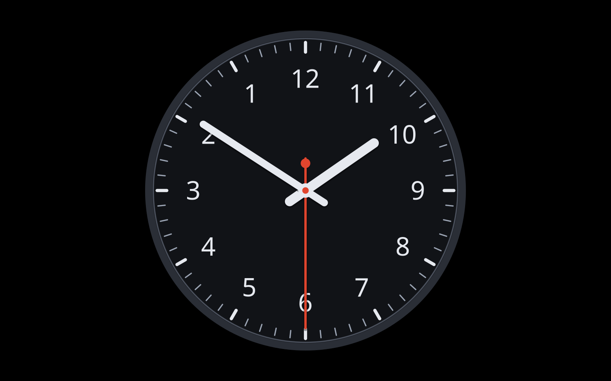

# Anti-Clock

## What it is

An analog watch whose hands sweep anticlockwise, run fullscreen as a
screensaver on Ubuntu GNOME (X11), either as a single HTML page in a Chrome
kiosk or as a native xscreensaver hack that also works while the screen is locked.
By default the dial is mirrored too (12 at the top, 3 on the LEFT, 6 at the
bottom, 9 on the RIGHT), so the watch still reads the correct time, just
backwards. Add `?mirror=0` to keep a normal dial under the backwards hands.

Burn-in protection is built in: the whole watch drifts slowly around the screen
on a Lissajous path (periods of 97 s and 131 s, amplitude 4 % of the shorter
screen edge, about 43 px on a 1080p display), so no pixel shows a static image
for long. It is on by default in both modes; `?drift=0` or `--no-drift` turns it
off, which is only useful for screenshots. The xscreensaver setup also turns the
display off after an hour of idle time.

## Getting the code

    git clone https://github.com/exirifard/anti-clock.git /archive/screensaver

The examples in this file assume the checkout lives at `/archive/screensaver`.
If you clone it somewhere else, substitute your own path in the commands below.

## Quick look

To watch it live in a normal browser window (it will not close when you move
the mouse; press F11 for fullscreen):

    google-chrome --new-window "file:///archive/screensaver/index.html?exit=0"

To freeze the time for a screenshot or test:

    file:///archive/screensaver/index.html?time=03:00:00

At 03:00 the hour hand points LEFT (the screen 9 o'clock position); at 09:00
it points RIGHT.

## Run as screensaver

This is the unlocked (Chrome kiosk) mode: it only runs while the session is
unlocked. The xscreensaver mode in the next section replaces it (its setup
script retires this watcher) and also works while the screen is locked.

One-off fullscreen session (Chrome kiosk mode, closes on any key press or
mouse movement):

    ./run.sh

Autostart the idle watcher at login:

    ./install.sh

The watcher launches `run.sh` after the user has been idle for `IDLE_SECONDS`
seconds (default 120). For a manually started watcher, override it in the
environment, for example `IDLE_SECONDS=60 ./idle-watcher.sh`.

The autostart entry written by `install.sh` does not read your shell
environment, so the autostarted watcher always uses the default 120 unless you
edit `~/.config/autostart/anticlockwise-watch.desktop` and change its `Exec`
line to, for example:

    Exec=env IDLE_SECONDS=60 /archive/screensaver/idle-watcher.sh

NOTE: GNOME itself blanks the screen after 300 s (and locks). `IDLE_SECONDS`
must be smaller than that, or disable GNOME blanking yourself:

    gsettings set org.gnome.desktop.session idle-delay 0

`install.sh` never changes gsettings for you. To remove the autostart entry and
stop a running watcher:

    ./uninstall.sh

`run.sh` uses a throwaway Chrome profile under
`${XDG_RUNTIME_DIR:-/tmp}/anticlockwise-watch-profile`, so your real Chrome
profile is never touched. `CHROME_BIN` overrides the browser binary
(default `google-chrome`).

## Locked-screen mode with xscreensaver

GNOME's lock screen is drawn by GNOME Shell and cannot show other applications,
so the Chrome version can never appear while the screen is locked. The watch is
therefore also a native xscreensaver "hack" (`xscreensaver/anticlock-watch.py`,
Python/GTK drawing with cairo into the window xscreensaver hands it via
`XSCREENSAVER_WINDOW`); xscreensaver does the blanking, locking and password
prompt. Prerequisites (already installed): `xscreensaver`, `xscreensaver-gl`,
`xscreensaver-gl-extra`, plus `python3` with PyGObject (GTK 3) and pycairo.

Setup (`DRY_RUN=1` prints every action and the exact `~/.xscreensaver` content
without changing anything; `IDLE_MINUTES` default 2; `LOCK` default `True`;
`LOCK_TIMEOUT` default `0:00:00` = lock as soon as the saver starts; `STATE_DIR`
default `~/.config/anticlockwise-watch`); what it does, in order:

    xscreensaver/setup-xscreensaver.sh

1. Checks preconditions (xscreensaver tools, gsettings, python3 `gi`/`cairo`).
2. Backs up the GNOME settings it changes to `$STATE_DIR/gnome-settings.backup`
   (first run only), then sets `lock-enabled false`, `idle-delay 0`,
   media-keys `screensaver ['']` and, if present, `idle-activation-enabled false`.
   Power/suspend settings are not touched (see Settings > Power).
3. Adds a custom keybinding "Lock screen (XScreenSaver)": Super+L runs
   `xscreensaver-command -lock`. Existing custom keybindings are kept.
4. Writes `~/.xscreensaver` (old one kept as `~/.xscreensaver.bak.<timestamp>`):
   mode `one`, timeout from `IDLE_MINUTES`, lock settings, DPMS, this hack only.
5. Writes `~/.config/autostart/xscreensaver.desktop` (the stock entry is XFCE-only).
6. Retires the Chrome watcher via `./uninstall.sh` if installed or running.
7. Starts (or restarts) the daemon and prints `xscreensaver-command -time`.
8. Prints a summary and testing hints.

Testing:

    xscreensaver-command -activate      # show the saver now (password needed if LOCK=True)
    xscreensaver-command -deactivate    # unblank; while LOCKED this only pops the password dialog
    xscreensaver-command -lock          # lock immediately (same as Super+L)
    xscreensaver-settings               # GUI with a live preview of the hack
    xscreensaver/anticlock-watch.py --window                  # hack alone; Esc or q quits
    xscreensaver/anticlock-watch.py --once /tmp/watch.png --time 03:00 --size 1280x800
    python3 xscreensaver/test_watchface.py                    # unit tests, exit 0 = pass

Escape hatch if you are locked out (forgotten password, PAM trouble, hung hack):
switch to a text console with Ctrl+Alt+F3 (or ssh in), log in there and run

    pkill -TERM -x xscreensaver

then switch back to the desktop VT (Ctrl+Alt+F2 on a stock Ubuntu session).
SIGTERM makes the daemon release the display and exit cleanly; never `kill -9`
it (the man page warns this can leave X in an inconsistent state). Note that
`xscreensaver-command -exit` is ignored while the display is locked and
`-deactivate` only brings up the password dialog, so neither is an escape.

`--once` renders one PNG without GTK or a display. Other hack options: `--time
HH:MM[:SS]`, `--mirror 0`, `--no-drift`, `--no-seconds`, `--fps N`, `--fullscreen`.
Super+L is rebound to `xscreensaver-command -lock`. Setup disables only GNOME's
*idle* lock and its Super+L binding (`lock-enabled false`, media-keys
`screensaver ['']`). GNOME's explicit lock paths are NOT disabled by that: the
Lock entry in the top-bar menu, `loginctl lock-session`, and lock-on-suspend
(`org.gnome.desktop.screensaver ubuntu-lock-on-suspend`, left at `true`; setup
does not touch `org.gnome.desktop.lockdown disable-lock-screen` either) still
bring up GNOME Shell's own lock screen, which then fights xscreensaver for the
X input grab. Lock with Super+L or `xscreensaver-command -lock` instead, and if
you suspend often consider running
`gsettings set org.gnome.desktop.screensaver ubuntu-lock-on-suspend false`
yourself (setup/teardown neither set nor restore it).

Two general xscreensaver caveats: it cannot blank or lock while any application
or GNOME Shell holds an input grab (an open menu or popup, the Activities
Overview, a drag in progress), so the idle timeout silently waits until the grab
is released; and Ctrl+Alt+F* switches away from the locked X display to a text
console, which is protected only by its own login prompt.

To revert everything (`DRY_RUN=1` supported; pass the same `STATE_DIR` you used
for setup, or teardown falls back to Ubuntu defaults): `xscreensaver/teardown-xscreensaver.sh`
restores the backed-up GNOME settings, removes the Super+L keybinding and the
autostart entry, exits the daemon and restores the previous `~/.xscreensaver`
(or removes ours). Re-enable the Chrome watcher with `./install.sh`.

## URL parameters

| Parameter    | Default | Effect                                               |
|--------------|---------|------------------------------------------------------|
| `time=`      | now     | Freeze the displayed time: `HH:MM`, `HH:MM:SS`, `HH:MM:SS.mmm` |
| `mirror=0`   | 1       | Normal (clockwise) dial under anticlockwise hands    |
| `drift=0`    | 1       | Disable the slow burn-in drift of the whole watch    |
| `seconds=0`  | 1       | Hide the second hand                                 |
| `smooth=0`   | 1       | Ticking second hand instead of a sweeping one        |
| `exit=0`     | 1       | Do not close on key/mouse input (preview in a normal browser window) |

## Files

| File                     | Purpose                                                        |
|--------------------------|----------------------------------------------------------------|
| `index.html`             | Page shell with `<canvas id="clock">` and script tags           |
| `style.css`              | Fullscreen black page, hidden cursor                           |
| `js/clockmath.js`        | Pure math (`ClockMath`), usable in browser and node            |
| `js/dial.js`             | `drawDial(ctx, cx, cy, r, theme, mirror)`: static face         |
| `js/hands.js`            | `drawHands(ctx, cx, cy, r, angles, theme)`: hour/minute/second |
| `js/main.js`             | Canvas setup, animation loop, drift, URL params, exit-on-input |
| `test/clockmath.test.js` | Node tests for the math                                        |
| `run.sh`                 | Launch fullscreen kiosk Chrome; close on user input            |
| `idle-watcher.sh`        | Background loop; runs `run.sh` after `IDLE_SECONDS` idle       |
| `install.sh`             | Writes `~/.config/autostart/anticlockwise-watch.desktop`       |
| `uninstall.sh`           | Removes the desktop file, kills a running watcher              |
| `xscreensaver/watchface.py` | Pure cairo drawing + math (`draw_watch`, `hand_angles`, ...) |
| `xscreensaver/test_watchface.py` | Python unit tests for `watchface.py`                    |
| `xscreensaver/anticlock-watch.py` | The xscreensaver hack (embedded, `--window`, `--once`) |
| `xscreensaver/setup-xscreensaver.sh` | Configure xscreensaver + GNOME, retire Chrome watcher |
| `xscreensaver/teardown-xscreensaver.sh` | Revert everything setup did                      |
| `README.md`              | This file                                                      |

## Testing

Unit tests (exit code 0 means pass):

    node test/clockmath.test.js

Show the exact Chrome command without launching anything:

    SCREENSAVER_DRY_RUN=1 ./run.sh

Show the `.desktop` file and chmod list `install.sh` would write, without
changing anything:

    DRY_RUN=1 ./install.sh

Run a single idle check instead of looping:

    ./idle-watcher.sh --once

Headless screenshot of a fixed time:

    google-chrome --headless=new --disable-gpu --window-size=1280,800 \
      --user-data-dir=/tmp/anticlockwise-watch-headless \
      --screenshot=/tmp/watch.png \
      "file:///archive/screensaver/index.html?time=03:00:00&drift=0"

The `--user-data-dir` must be a directory separate from any running Chrome's
profile. Without it, Chrome targets your default profile and, if your regular
Chrome is open, aborts with "Failed to create a ProcessSingleton for your
profile directory" and writes no PNG.

## How the anticlockwise geometry works

All angles are ordinary clock angles: theta in radians from 12 o'clock,
increasing clockwise, so `ClockMath.handAngles(date)` is the same as for a
normal watch. The only trick is `ClockMath.pointAt(cx, cy, r, theta, mirror)`,
which with `mirror=true` returns `x = cx - r*sin(theta)` instead of
`cx + r*sin(theta)`, reflecting every point across the vertical axis. The hands
are always drawn mirrored, so they sweep anticlockwise; the dial numerals use
the `mirror` setting, so by default they are reflected too and the time still
reads correctly.
